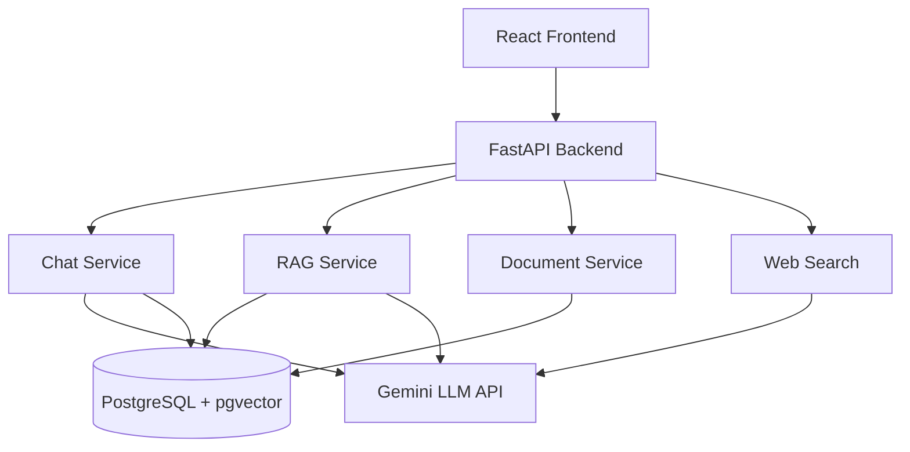

# Multimodal AI Chatbot

A beginner-friendly Multimodal AI Chatbot MVP built with React, FastAPI, and PostgreSQL. It understands text and document uploads, utilizes Retrieval-Augmented Generation (RAG) using pgvector, and can search the web for the latest information.

## Features

* **Multimodal input:** Upload documents and chat.
* **Multimodal AI interaction:** Understands text and processes documents for RAG.
* **RAG (Retrieval-Augmented Generation):** Uses pgvector for document semantic search.
* **Web search:** Uses DuckDuckGo search API to fetch current information when requested.
* **Document creation:** Generate new text files from chat.
* **Emotional assistance:** Empathetic conversational capability baked in via prompting and LLM capabilities.
* **Conversation memory:** Remembers the context of your chat.

## Architecture



## Tech Stack

* **Frontend:** React, Vite, Vanilla CSS
* **Backend:** FastAPI, Python
* **Database:** PostgreSQL with pgvector, SQLAlchemy (pg8000)
* **LLM API:** Google Gemini (google-genai SDK)
* **Embedding Model:** text-embedding-004
* **Web Search API:** DuckDuckGo Search

## Project Structure

* `backend/`: FastAPI application containing all server-side logic, API endpoints, AI providers, and database schemas.
* `frontend/`: React application built with Vite containing the ChatUI, components, and API service integration.

## Prerequisites

* Python 3.9+
* Node.js & npm
* PostgreSQL (with pgvector extension installed)
* Git

## Installation

```bash
git clone <repository>
cd Chatbot
```

### Backend Setup

1. Navigate to the backend directory and set up a virtual environment:

```powershell
cd backend
python -m venv venv
.\venv\Scripts\activate
```

2. Install the dependencies:

```powershell
pip install -r requirements.txt
```

3. Set up the environment variables:
Copy `.env.example` to `.env` and fill in your Gemini API key.

```powershell
copy .env.example .env
```

### Database Setup

Ensure PostgreSQL is running on your machine and create a database named `multimodal_ai`. The application will automatically create the required tables and the `vector` extension upon startup. Make sure you have installed the pgvector extension in your Postgres installation.

### Frontend Setup

1. Open a new terminal and navigate to the frontend directory:

```powershell
cd frontend
npm install
```

## Running the Application

### Start the Backend

Make sure your virtual environment is active:

```powershell
cd backend
uvicorn app.main:app --reload
```

The API will be available at `http://localhost:8000`. You can view the API documentation at `http://localhost:8000/docs`.

### Start the Frontend

```powershell
cd frontend
npm run dev
```

The frontend will be available at `http://localhost:5173`.

## RAG Workflow

When a user uploads a document, the system follows this workflow:
1. **Upload:** File is sent to backend.
2. **Extract:** Text is extracted from PDF, DOCX, TXT, or Markdown.
3. **Chunk:** The text is split into manageable pieces.
4. **Embed:** The chunks are converted into vector embeddings using the embedding model.
5. **Store:** Embeddings and metadata are saved in PostgreSQL using pgvector.
6. **Retrieve:** When a user asks a question, the system queries the database for similar chunks.
7. **Generate:** Relevant chunks are passed to the LLM to generate a grounded answer.

## Web Search Workflow

If a user asks for current information (e.g., using keywords like "search web", "latest", "today"), the Chat Service triggers the DuckDuckGo Search API, retrieves the latest snippets, and feeds them to the LLM as context to answer the question accurately.

## Emotional Assistance

The chatbot uses state-of-the-art LLMs equipped with natural language understanding to provide empathetic and supportive responses when users share emotional distress. Note: *This system is for conversational support only and is not a replacement for professional mental health care.*

## Limitations

* **MVP Scope:** This application lacks user authentication and role-based access.
* **Document Update:** Modifying documents currently relies on LLM rewriting which can be experimental.
* **pgvector:** Requires local postgres installation to be configured with the pgvector extension.

## Future Improvements

* Add User Authentication & Login/Signup
* Admin dashboard
* Support for vector databases like Pinecone/Milvus for scale
* Streaming responses for faster UI feel
* Multi-tenant architecture for enterprise deployment
